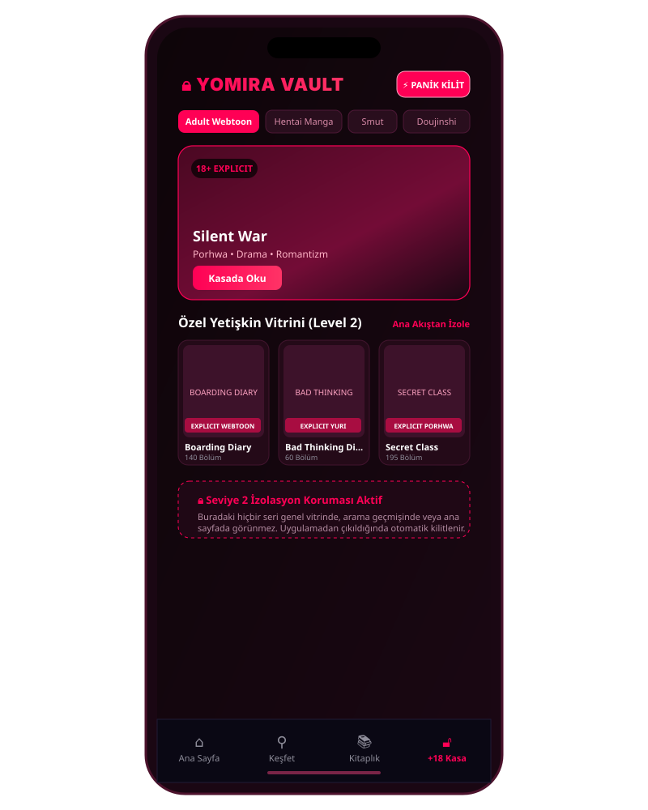
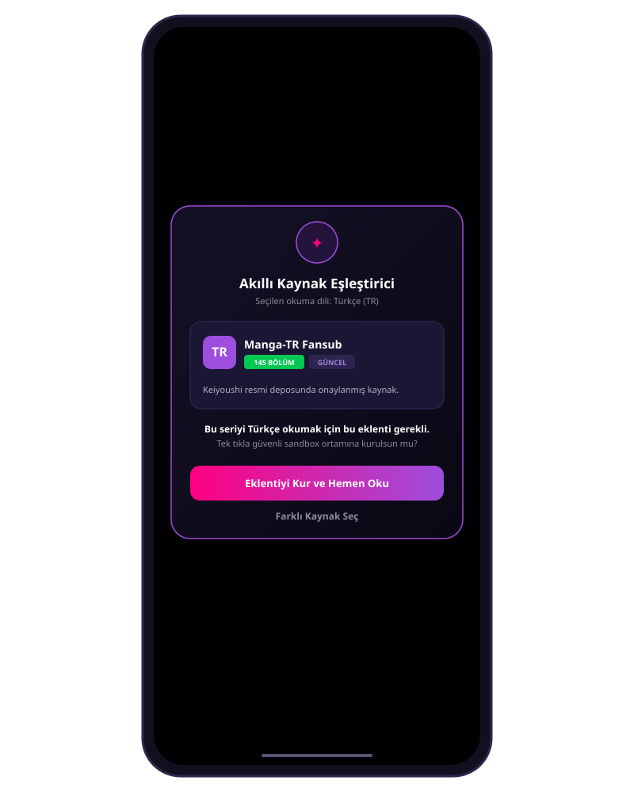

<div align="center">


# 🌌 YOMIRA
### Evrensel Çizgi Roman & Manga Ekosistemi

[](https://github.com/PaelenRune/Yomira/releases)
[](https://github.com/PaelenRune/Yomira)
[](https://kotlinlang.org/)
[](https://developer.android.com/jetpack/compose)
[](LICENSE)

<br/>

**Manga, Webtoon, Manhwa, Manhua, Western (Marvel/DC/Image) ve Yetişkin (+18) serileri tek bir çatı altında birleştiren, Dribbble ilhamlı OLED arayüze ve Keiyoushi eklenti motoruna sahip yeni nesil Android okuma platformu.**

[📱 **Beta APK İndir (v0.1.0-beta)**](https://github.com/PaelenRune/Yomira/releases/download/v0.1.0-beta/yomira-v0.1.0-beta.apk) • [🌐 **Ürün Tanıtım Sayfası (GitHub Pages)**](https://paelenrune.github.io/Yomira/) • [📋 **Sürüm Notları**](release/RELEASE_NOTES.md)

</div>

---

## 📱 Görsel Vitrin & Arayüz

Yomira, Ronas IT'nin ödüllü Dribbble tasarım dilinden ilham alarak **Deep OLED Black (`#06050C`)**, füme cam efektli kartlar ve mor/fuşya neon vurgular ile inşa edilmiştir.

| 📱 Ana Sayfa & Vitrin | 🔒 +18 Vault (Kasa) |
| :---: | :---: |
|  |  |
| *Hero Carousel, 2/3/4 Sütun Izgara Seçici, Seviye 1 (Mature) Rozeti* | *PIN / Biyometrik Korumalı Bağımsız Ana Sayfa, Panik Butonu* |

| 📖 Evrensel Okuyucu | ✦ Akıllı Kaynak Eşleştirici |
| :---: | :---: |
|  |  |
| *Webtoon Dikey Akış, Manga (RTL) / Western (LTR), OLED Siyah & Ters Renk* | *Tercih Edilen Dilde (TR/EN) En Güncel Kaynağı Tek Tıkla Kurma* |

---

## ✨ Temel Prensip ve Özellikler

### 1. 🛡️ İçeriksiz Çekirdek (Content-Free Core)
Yomira **içerik dağıtıcısı veya korsan barındırıcı değildir**. Uygulama içine tek bir telifli görsel veya bölüm gömülmez. Saf, yasal bir katalog tarayıcısı, görselleştirici ve okuma arayüzüdür. Okunabilir içerik, kullanıcıların harici Keiyoushi / Tachiyomi depoları bağlamasıyla yüklenir.

### 2. 🌊 Kademeli Metadata Şelalesi (Waterfall Aggregator)
Evrendeki her serinin afişi, konusu, yazarı ve puanı eksiksiz listelenir:
```
[Baka-Updates] (Kanonik Omurga, Yazar/Çizer, Alt Türler)
       ↓ (Eksik alanları tamamla)
[AniList GraphQL] (Ultra HD Kapak/Banner, Topluluk Puanı, Trendler)
       ↓ (Alternatif başlıkları ve derecelendirmeyi doğrula)
[MangaDex v5] (Çok Dilli Başlıklar, 4 Seviyeli ContentRating)
       ↓ (Özet ve çıkış tarihi fallback'i)
[Kitsu API]
       ↓ (Marvel, DC, Image Comics Western serileri)
[ComicVine API]
```

### 3. ⚖️ Seviye 0–1–2 Akıllı İçerik Ayrıştırma Motoru
Yomira'nın en hassas algoritması, erotik/hikaye dengeli seriler ile saf pornografik içerikleri yapay olarak karıştırmaz:

| Seviye | Kategori | Örnekler | Görünürlük Kuralı |
| :---: | :---: | :---: | :---: |
| **Level 0** | **SAFE** | *One Piece, Solo Leveling, Spider-Man* | Genel vitrin, ana sayfa, keşfet ve her yerde serbest. |
| **Level 1** | **MATURE / ECCHI** | *I Formed a MILF Party with the Heroes' Mothers*, *Kimi wa Midara na Boku no Joou*, *Prison School* | **Saf pornografi DEĞİLDİR!** Hikâye odaklıdır; ana sayfada **16+ / Mature** rozetiyle listelenir. |
| **Level 2** | **EXPLICIT (PORNOGRAFİ)** | Saf Hentai mangaları, cinsel porhwa ve erotik webtoonlar | **Ana sayfadan tamamen izole edilir!** Yalnızca PIN/Biyometrik kilitli **+18 Vault** alanında görünür. |

### 4. 🔌 Keiyoushi Eklenti Entegrasyonu & Akıllı Eşleştirici (Smart Matcher)
- Kullanıcı onlarca fansub sitesinde arama yapmakla uğraşmaz.
- Seriye tıklandığında seçilen dile (TR/EN) göre en güncel ve en yüksek bölüm sayılı kaynak arka planda tespit edilir.
- Eklenti kurulu değilse: *"Bu seriyi Türkçe okumak için en iyi kaynak: [Manga-TR] (145 Bölüm). Bu eklentiyi tek tıkla kurmak ister misiniz?"* modalı çıkar ve tek dokunuşla hazır hale gelir.

### 5. 📖 Evrensel Okuyucu Motoru (Universal Reader Engine)
- **Webtoon Modu:** Kesintisiz dikey kaydırma (`LazyColumn`), bellek korumalı donanım render'ı.
- **Manga (RTL) & Western (LTR) Modu:** Akıcı yatay sayfa çevirme motoru.
- **Smart Zoom:** Çift dokunuş panel odaklama ve serbest kıstırma (Pinch-to-zoom).
- **OLED Gece Modu & Ters Renkler:** Gece okumaları için tam kontrast seçeneği.

### 6. ☁️ Google Drive AppData Senkronizasyonu
- Kullanıcının gizli `drive.appdata` alanında çalışan hafif JSON (`yomira_sync.json`).
- Ana Drive'ı kirletmez, resim yüklemez, kullanıcı depolama kotasını tüketmez.
- **"Max Progress Wins"** çakışma çözücü: Farklı cihazlar arasında en ileri okunan bölüm/sayfa korunur ve kütüphaneler birleştirilir.

---

## 🚀 Hızlı Kurulum

1. [Releases](https://github.com/PaelenRune/Yomira/releases) sayfasından en son `yomira-v0.1.0-beta.apk` dosyasını indirin.
2. Android cihazınızda indirdiğiniz APK'yı açarak yüklemeyi onaylayın.
3. İlk açılış Onboarding sihirbazında okuma dilinizi (Türkçe/İngilizce) seçin ve Keiyoushi deposunu bağlayın.
4. Keyifle okumaya başlayın!

```bash
# ADB ile doğrudan yükleme
adb install -r release/yomira-v0.1.0-beta.apk
```

---

## 🏗️ Teknoloji Yığını ve Modüller

```
yomira/
├── app/                  # Application kökü, Hilt DI, Navigation Compose
├── core/
│   ├── model/            # Bağımsız Domain modelleri (Manga, Chapter, Rating)
│   ├── database/         # Room Database v3, DAO'lar, Hibrit Önbellek
│   ├── network/          # Ktor/OkHttp istemcileri (Baka, AniList, MangaDex, Kitsu, ComicVine)
│   └── ui/               # OLED Tasarım Sistemi, Hero Carousel, Izgara Seçici
├── data/
│   ├── metadata/         # Waterfall Aggregator (Kademeli birleştirici)
│   ├── extension/        # Keiyoushi Sandbox Eklenti Köprüsü
│   └── sync/             # Google Drive AppData REST API istemcisi
├── domain/
│   ├── classifier/       # Level 0–1–2 İçerik Karar Motoru
│   ├── extension/        # Smart Source Matcher & Onboarding Sihirbazı
│   └── sync/             # Max Progress Wins Çakışma Çözücü
└── feature/
    ├── home/             # Ana Sayfa (Trendler, Güncellemeler, 2/3/4 Sütun)
    ├── vault/            # +18 Kasa (PIN Kilitli İkinci Ana Sayfa, Panik Butonu)
    ├── details/          # Seri Detay Ekranı ve Bölüm Listesi
    └── reader/           # Evrensel Okuyucu Motoru (Webtoon, RTL, LTR, OLED)
```

---

## 🧪 Test ve Doğrulama Durumu

- **Birim Testleri:** 96/96 test başarılı (`testDebugUnitTest`).
- **Lint Durumu:** 0 hata (`lintReport`).
- **Katalog İzolasyonu:** SAFE, MATURE ve EXPLICIT sınırlarının sızdırmazlığı birim testlerle kanıtlandı.

---

## 📄 Lisans

Yomira, [Apache License 2.0](LICENSE) kapsamında açık kaynak olarak lisanslanmıştır.
Telif Hakkı © 2026 **PaelenRune**. Tüm hakları saklıdır.
