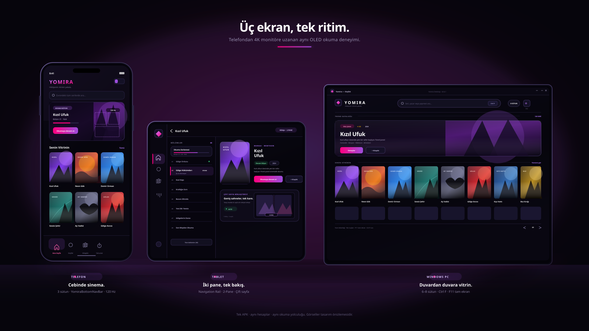
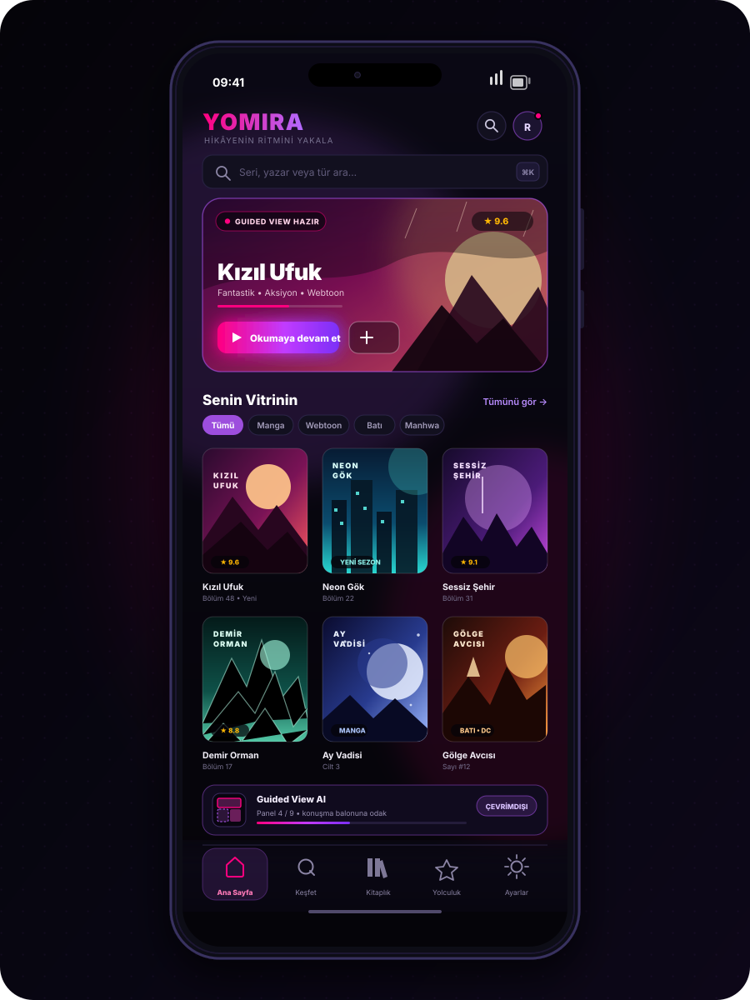
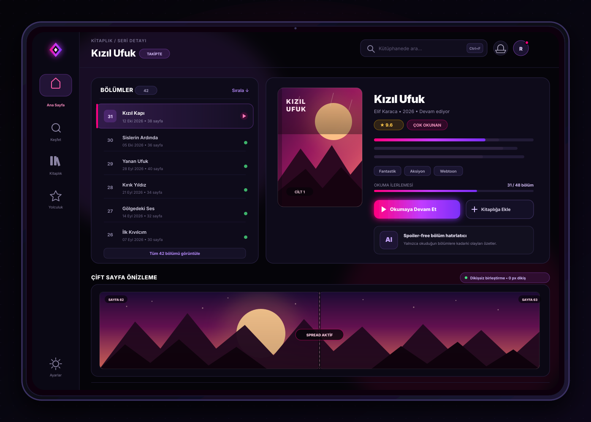
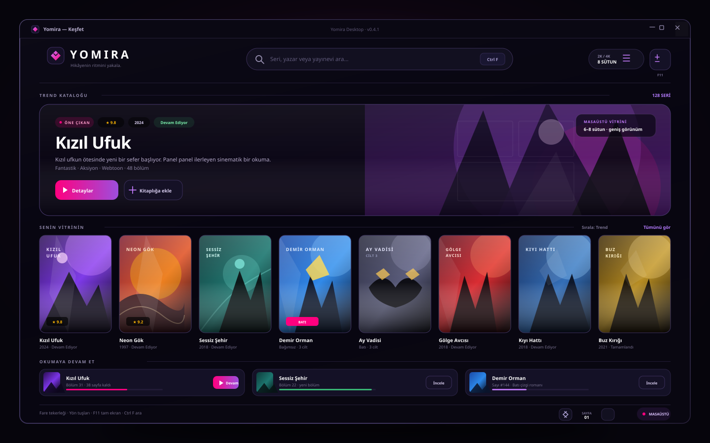

<div align="center">


# YOMIRA
### Hikâyenin ritmini yakala.

[](https://github.com/PaelenRune/Yomira/releases/latest)
[](https://github.com/PaelenRune/Yomira/releases/latest)
[](https://developer.android.com/jetpack/compose)
[](LICENSE)

**Manga, webtoon, manhwa, manhua ve Batı çizgi romanları için açık kaynak çok platformlu okuma deneyimi. Android ve bağımsız Windows masaüstü, Dribbble ilhamlı OLED tasarım, Türkçe / English arayüz ve sana ait bir okuma yolculuğu.**

[**Android için indir**](https://github.com/PaelenRune/Yomira/releases/latest) · [**Windows için indir (.EXE / .MSI)**](https://github.com/PaelenRune/Yomira/releases/latest) · [**Ürün vitrini**](https://paelenrune.github.io/Yomira/) · [**English overview**](#english)

</div>

---

## 🌟 Son Sürüm: v0.4.1 ile Neler Geldi?

**Acil kararlılık, sabit imza ve hazır depo güncellemesi.** Bu sürüm, günlük kullanımda karşılaşılan açılış sorunlarını kapatır, güncelleme akışını tek dokunuşa indirir ve ilk kurulumda okumaya hazır bir kütüphane sunar.

- 🛡️ **Samsung Galaxy A37 ve Android 14/15 açılış çökmesi tamamen giderildi.** AndroidX Startup `InitializationProvider` birleştirmesi onarıldı; `ProcessLifecycleOwner` ile `EmojiCompat` sağlayıcıları artık silinmiyor. Room tarafında `fallbackToDestructiveMigration` güvencesi eklendi ve Samsung One UI 6'nın tetiklediği dil değiştirme / yeniden oluşturma döngüsü durduruldu.
- 🔑 **Sabit İmzalama Keystore'u.** Repoya kalıcı bir imza anahtarı eklendi; hem debug hem release derlemeleri aynı sertifikayı taşıyor. Artık eski sürümü silmeye gerek kalmadan doğrudan **“Güncelle”** butonuyla üzerine kurulur.
- 📦 **3 Ana Depo Gömülü Geliyor.** Keiyoushi, Türkçe Çizgi Roman & Manga ve Batı Çizgi Romanları depoları ilk kurulumdan itibaren aktif. URL girmek, indeks aramak veya ek adım atmak gerekmiyor.
- 🖥️ **Resmî Windows Dağıtımı.** `Yomira-0.4.1.exe` ve `Yomira-0.4.1.msi` GitHub Releases sayfasında yayında; her sürümde `windows-latest` üzerinde otomatik derleniyor.
- 📱 **Tek APK, iki düzen.** Aynı APK telefon ve tablet/katlanabilir ekranlarda çalışır; ekranı algılayıp navigasyon biçimini kendisi seçer.

---

## 📥 Hangi Dosyayı İndirmeliyim?

| Cihazın | İndireceğin dosya | Ne alıyorsun? |
| :--- | :--- | :--- |
| 📱 **Android Telefon** | `yomira-v0.4.1.apk` | Alt gezinme çubuğu, 2–3 sütunlu poster vitrini, Guided View AI panel odaklanması. |
| 📟 **Android Tablet / Katlanabilir** | `yomira-v0.4.1.apk` | **Tek evrensel APK!** Ekranı algılayıp otomatik olarak **Navigation Rail (Yan Gezinme Rayı)** ve **2-Pane** moduna geçer; çift sayfa spread desteklenir. |
| 🖥️ **Windows PC (Hızlı Başlatıcı)** | `Yomira-0.4.1.exe` | Kurulumsuz, doğrudan çalışır. 2K/4K ekranlarda 6–8 sütunlu ızgara, `Ctrl+F` arama, `F11` tam ekran. |
| 🖥️ **Windows PC (Sistem Kurucusu)** | `Yomira-0.4.1.msi` | Başlat menüsü kısayollu resmî kurulum; kaldırma kaydı ve sürüm yükseltmesi Windows tarafından yönetilir. |

> **Not:** Android tarafında tek dosya yeterli — telefon ile tablet için ayrı APK indirmen gerekmiyor. Windows'ta taşınabilir deneyim istiyorsan `.exe`, sistem geneline kurmak istiyorsan `.msi` dosyasını seç.
>
> **Minimum sistem:** Android 8.0+ (API 26+) · Windows 10/11. İndirdiğin dosyanın bütünlüğünü sürümle birlikte yayınlanan `SHA256SUMS.txt` ile doğrulayabilirsin.

<!-- release-links -->
**Doğrudan bağlantılar:** [`yomira-v0.4.1.apk`](https://github.com/PaelenRune/Yomira/releases/latest/download/yomira-v0.4.1.apk) · [`Yomira-0.4.1.exe`](https://github.com/PaelenRune/Yomira/releases/latest/download/Yomira-0.4.1.exe) · [`Yomira-0.4.1.msi`](https://github.com/PaelenRune/Yomira/releases/latest/download/Yomira-0.4.1.msi)

---

## 🖼️ Üç Ekran, Üç Kusursuz Deneyim

Aynı kütüphane, aynı kaldığın yer; ekranın boyutuna göre şekillenen tek bir arayüz dili.

<div align="center">



*Telefon, tablet ve Windows masaüstü — aynı OLED tasarım sistemi, üç farklı düzen.*

</div>

### 📱 Telefon — tek elle, akıcı akış

<div align="center">

</div>

- **2 / 3 / 4 sütun** arasında tek dokunuşla geçiş; poster odaklı vitrin rafları.
- **`YomiraBottomNavBar`** ile Ana Sayfa, Keşfet, Kitaplık, Yolculuk ve Ayarlar her an başparmağın altında.
- Kart üzerindeki **Guided View AI** şeridi panel ilerlemesini gösterir: “Panel 4 / 9 • konuşma balonuna odak”, tamamen çevrimdışı.
- Kaldığın bölümü hatırlayan “Okumaya devam et” kartı ve ilerleme çubuğu.

### 📟 Tablet & Katlanabilir — 2-Pane ve Navigation Rail



- Sol tarafta ince **Navigation Rail**; geniş ekranda yer kaybı yok.
- Sağda **2-Pane detay**: solda bölüm listesi, sağda kapak, künye, tür etiketleri ve okuma ilerlemesi.
- **Çift Sayfa Spread** önizlemesi dikişsiz birleştirmeyi gösterir — “0 px dikiş”.
- Bölüm satırlarında okundu durumu, tarih ve sayfa sayısı; altında spoiler-free hatırlatıcı kartı.

### 🖥️ Windows Masaüstü — büyük ekranın hakkını veren ızgara



- 2K/4K monitörlerde **6–8 sütunlu** dev poster ızgarası; `Ctrl+F` ile anında arama, `F11` ile tam ekran.
- Üst **masthead** barında gezinme, arama ve sürüm rozeti; başlık çubuğunda gerçek Windows denetimleri.
- Fare tekerleği ve yön tuşlarıyla webtoon kaydırma; altta “Okumaya devam et” şeridi.
- Aynı Reading Journey verileri: seviye, XP ve haftalık okuma özeti masaüstünde de görünür.

### Arayüzden iki yakın plan

| Ana sayfa | Evrensel okuyucu |
| :---: | :---: |
|  |  |

*Görseller tasarım önizlemeleridir; cihaz ve sürüme göre görünüm değişebilir.*

---

## 🚀 Okumaya odaklan

- **120 Hz akıcı okuyucu:** Uyumlu ekranlarda akıcı geçişler; manga için sağdan sola, Batı çizgi romanları için soldan sağa, webtoon için kesintisiz dikey akış. 120 Hz uyumlu seam sökücü ve donanım bitmap geri dönüşüm havuzu ile hafızada hafif, ekranda pürüzsüz. Gerçek yenileme hızı cihaz ve sistem ayarlarına bağlıdır.
- **Guided View (Akıllı Panel):** Cihaz üzerinde, internet gerektirmeden çalışan panel dedektörü ile panelden panele sinematik akış ve konuşma balonlarına net odaklanma. **Çift Sayfa Birleştirici** iki sayfaya bölünmüş geniş sahneleri sıfır dikişle yan yana getirir.
- **Yomira Reading Journey & Wrapped:** Cihazda kalan yerel okuma takip motoru; 4 kategori ve 4 kademeli rozetler, seviye & XP ilerlemesi. Aylık ve yıllık okuma alışkanlıklarını sinematik **Yomira Wrapped** slaytları ve paylaşılabilir kartlarla keşfet.
- **Spoiler-Free Bölüm Hatırlatıcı:** Uzun ara verdiğin seriye dönerken yalnızca *okuduğun* bölümlere kadarki olayları ve karakterleri özetler; gelecekten asla spoiler vermez.
- **Windows Masaüstü & Tablet 2-Pane:** Compose Multiplatform ile yazılmış bağımsız Windows uygulaması — 2K/4K monitörlerde 6-8 sütunlu poster ızgarası, F11 tam ekran, yön tuşları ve fare tekerleğiyle webtoon kaydırma. Tablet ve katlanabilirlerde dinamik 2-Pane düzen ve Yan Gezinme Rayı.
- **JSON-first eklenti ekosistemi:** Eklentiler sistem yükleyicisi gerektirmeden Yomira sandbox'ında çalışır; Keiyoushi ve topluluk depoları **gömülü** olarak gelir. **Mihon / Tachiyomi yedeklerini** (`.tachibk` veya JSON) tek dokunuşla içe aktar — kütüphane, kategoriler ve ilerlemeler seninle gelir.
- **Batı çizgi romanları:** Marvel, DC ve Image gibi yayınevlerinin eserlerini metadata kataloğunda keşfet; erişim hakkın bulunan kaynaklarla oku.
- **Dribbble OLED teması & çift dilli deneyim:** Derin siyah zemin, mor / fuşya vurgular, poster odaklı raflar; Türkçe [TR] ve English [EN] arayüz.

---

## 🗓️ Sürüm Güncellemeleri

Her sürümde bu bölüm güncellenir: hangi sürümde ne geldi, ne iyileştirildi.

### v0.4.1 — Kararlılık & Hazır Depo
> **Odak:** Açılış güvenilirliği, tek dokunuşla güncelleme, ilk kurulumda hazır kütüphane.

- **Düzeltildi:** Samsung Galaxy A37 ve Android 14/15 açılışta anında kapanma; AndroidX Startup sağlayıcı çakışması ve Room şema uyumsuzluğu.
- **Düzeltildi:** Samsung One UI 6'da dil ayarı sonrası sonsuz yeniden başlatma döngüsü.
- **Eklendi:** Kalıcı imzalama keystore'u — aynı sertifikayla imzalanan APK'lar üzerine sorunsuz güncellenir.
- **Eklendi:** Keiyoushi, Türkçe Çizgi Roman & Manga ve Batı Çizgi Romanları depoları gömülü ve varsayılan aktif.
- **Yeni:** Windows için `Yomira-0.4.1.exe` ve `Yomira-0.4.1.msi` otomatik dağıtımı.
- `versionCode 5` · `versionName 0.4.1`

### v0.4.0 — Ekosistem Sürümü
> **Odak:** Okuma yolculuğu, akıllı panel, masaüstü ve eklenti motoru.

- **Eklendi:** JSON-first eklenti motoru; APK'lar sandbox içinde çalışır, sistem yükleyicisi gerekmez.
- **Eklendi:** Mihon / Tachiyomi `.tachibk` ve JSON yedek içe aktarma.
- **Eklendi:** Yomira Reading Journey (4 kategori, 4 kademe rozet, seviye & XP) ve aylık/yıllık **Wrapped**.
- **Eklendi:** Guided View panel dedektörü, Çift Sayfa Geniş Sahne Birleştirici ve spoiler-free bölüm hatırlatıcı.
- **Yeni:** Bağımsız Windows masaüstü uygulaması ve tablet/katlanabilir için 2-Pane düzen.
- **İyileştirildi:** Onboarding iki adıma indirildi; okuma verileri cihazda kaldı.
- `versionCode 4` · `versionName 0.4.0`

### v0.3.0-beta — Keşif & Kişiselleştirme
> **Odak:** Sonsuz keşif, filtreleme, Batı çizgi romanları ve tam çift dil.

- **Eklendi:** Sonsuz kaydırma; AniList, MangaDex, ComicVine ve OpenLibrary kaynaklarından paralel sayfalama.
- **Eklendi:** 42 etiketli çoklu filtre matrisi (AND mantığı) ve TR/EN yerelleştirme.
- **Eklendi:** “Amerikan & Batı Çizgi Roman Dünyası” rafı; Marvel, DC, Image, Dark Horse, Vertigo, Skybound, IDW.
- **Eklendi:** Kanonik tekilleştirme (`CatalogMerger`) — aynı seri tek rafta toplanır.
- **Eklendi:** 185 string kaynağında tam EN/TR eşleşmesi ve yeni OLED ayarlar merkezi.
- **Yeni:** Neon elmas portal launcher ikonu ve adaptif yuvarlak varyant.
- `versionCode 3` · `versionName 0.3.0-beta`

Sürüm notlarının tamamı: [`release/RELEASE_NOTES.md`](release/RELEASE_NOTES.md)

---

## Üç platform, tek ritim

1. **Android:** [En güncel APK'yı](https://github.com/PaelenRune/Yomira/releases/latest) kur — tek dosya telefon, tablet ve katlanabilirlerde uyarlanabilir düzen sunar.
2. **Windows:** [Masaüstü sürümü](https://github.com/PaelenRune/Yomira/releases/latest) (`.EXE` taşınabilir / `.MSI` kurulum) ile büyük ekranda 6-8 sütunlu vitrin.
3. **Başla:** Okuma dilini seç (**Türkçe [TR] / English [EN]**); üç ana depo zaten bağlı. İstersen Mihon/Tachiyomi yedeğini içe aktar — hepsi daha sonra Ayarlar'dan da yönetilebilir.

## İçerik değil, okuma aracı

Yomira bölüm barındırmaz, dağıtmaz veya erişim hakkı sağlamaz. Katalog bilgileri ile okunabilir içerik birbirinden ayrıdır; eklentiler ve harici hizmetler kendi koşullarına tabidir. Yalnızca erişim hakkınız bulunan içerikleri kullanın ve eser sahiplerinin haklarına saygı gösterin. Yayıncı adları tanımlama amacıyla kullanılır; herhangi bir resmî ortaklık veya onay ima edilmez.

## Geliştiriciler için

Kotlin, Jetpack Compose, Compose Multiplatform, Hilt, Room ve modüler mimari üzerine kuruludur.

| Dizin | Sorumluluk |
| --- | --- |
| `app/` | Android uygulama başlangıcı, gezinme ve bağımlılık yönetimi |
| `desktop/` | Bağımsız Windows masaüstü uygulaması (Compose Multiplatform, EXE/MSI) |
| `core/` | Paylaşılan modeller, veri tabanı, ağ ve tasarım sistemi |
| `data/` | Metadata, eklenti ve senkronizasyon uygulamaları |
| `domain/` | İş kuralları, okuma yolculuğu motoru ve kaynak eşleştirme |
| `feature/` | Katalog, okuyucu, yolculuk, detay ve ayarlar deneyimleri |

```powershell
.\gradlew.bat assembleDebug
.\gradlew.bat testDebugUnitTest
.\gradlew.bat :desktop:packageDistributionForCurrentOS
```

Sorun bildirimlerinde platformu, işletim sistemi sürümünü ve yeniden üretme adımlarını paylaşın. Katkılar ve erişilebilirlik iyileştirmeleri memnuniyetle karşılanır.

## English

**Yomira is an open-source reader for manga, webtoons and Western comics — on Android and on a standalone Windows desktop app.** Enjoy an OLED-first interface inspired by Dribbble, Turkish / English navigation, a reader targeting smooth 120 Hz interaction, on-device Guided View panel navigation with spread stitching, Yomira Reading Journey achievements with shareable monthly Wrapped summaries, spoiler-free chapter recaps, and a sandboxed JSON-first extension engine that imports your Mihon / Tachiyomi backup in one tap.

**Latest — v0.4.1:** the Samsung Galaxy A37 / Android 14–15 startup crash is fixed (AndroidX Startup lifecycle and a Room migration fallback), release builds now share a permanent signing key so updates install over the previous version, three curated repositories ship enabled by default, and official `Yomira-0.4.1.exe` / `.msi` builds are published on the Releases page.

**Which file should I download?** One universal `yomira-v0.4.1.apk` covers both phones and tablets — it detects the screen and switches to a Navigation Rail with a two-pane layout automatically. On Windows choose the portable `.exe` or the `.msi` installer with Start-menu shortcuts.

Yomira does not host chapters or grant access to copyrighted works. Use only content you are entitled to access; publisher names do not imply endorsement.

[Download for Android](https://github.com/PaelenRune/Yomira/releases/latest) · [Download for Windows](https://github.com/PaelenRune/Yomira/releases/latest) · [Explore the product](https://paelenrune.github.io/Yomira/)

## Lisans / License

[Apache License 2.0](LICENSE) · © 2026 PaelenRune
