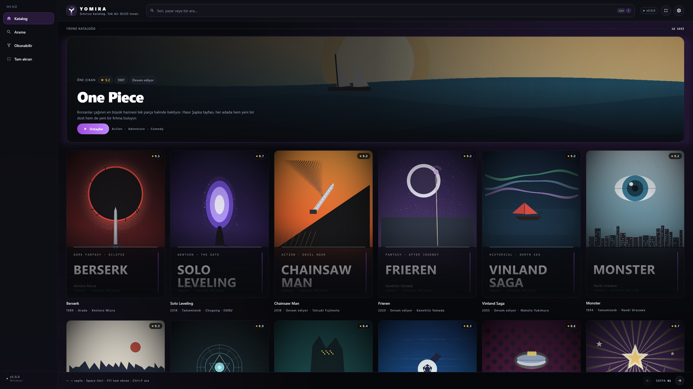
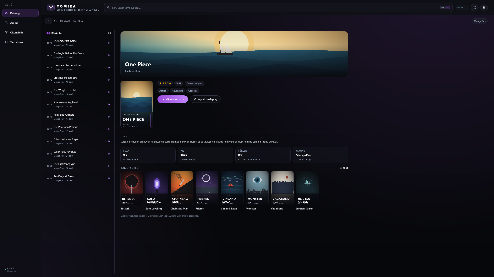
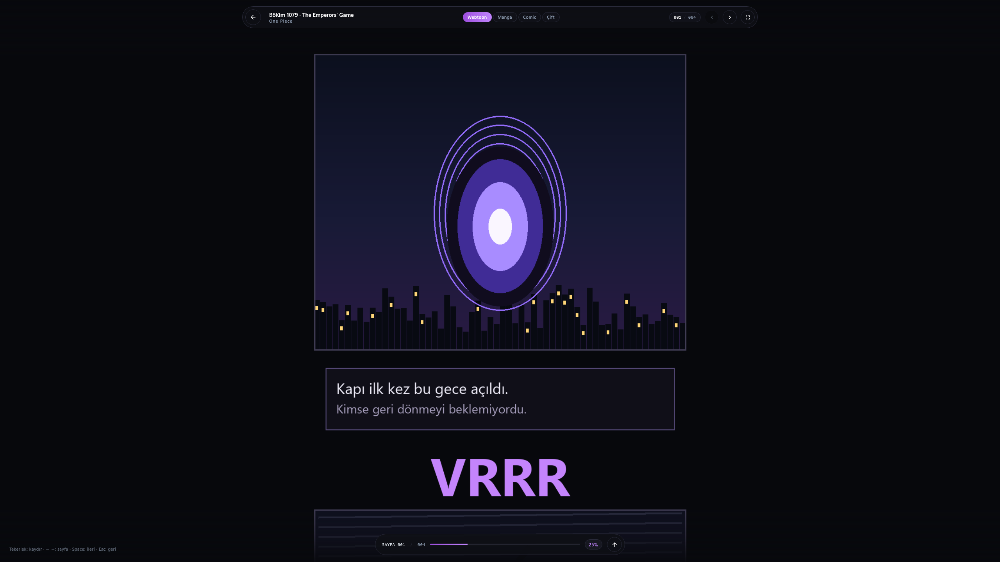
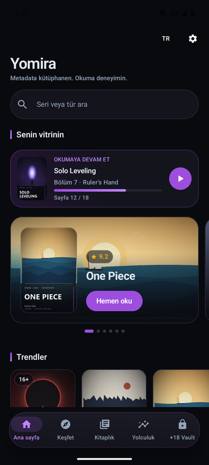
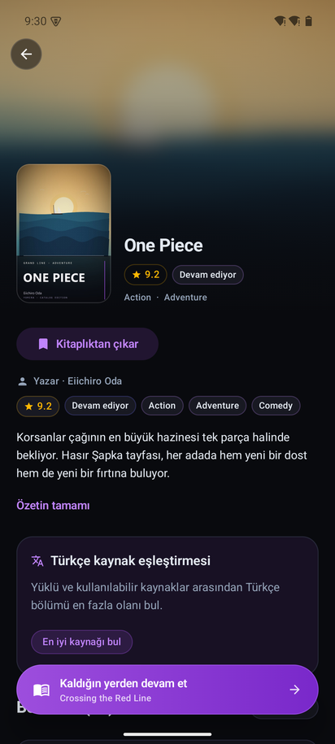
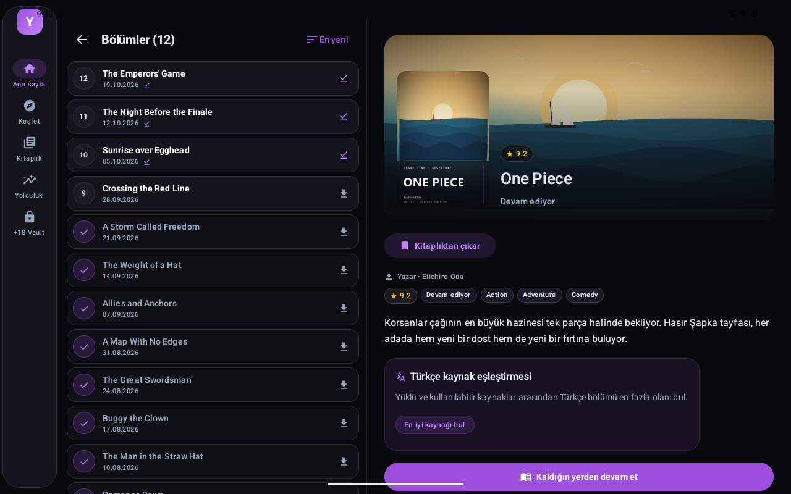

<div align="center">


# YOMIRA · v5.0

### Hikâyenin ritmini yakala.

[](https://github.com/PaelenRune/Yomira/releases/latest)
[](https://github.com/PaelenRune/Yomira/releases/latest)
[](https://github.com/PaelenRune/Yomira/releases/latest)
[](https://www.jetbrains.com/compose-multiplatform/)
[](LICENSE)

**Manga, webtoon, manhwa, manhua ve Batı çizgi romanları için açık kaynak, çok platformlu okuma deneyimi.**
Cstation vitrin düzeni, dikişsiz webtoon akışı ve tek bir OLED Plum teması — Android'de ve bağımsız Windows masaüstünde.

[**Android APK indir**](https://github.com/PaelenRune/Yomira/releases/latest/download/yomira-v5.0.0.apk) ·
[**Windows .EXE indir**](https://github.com/PaelenRune/Yomira/releases/latest/download/Yomira-5.0.0.exe) ·
[**Windows .MSI indir**](https://github.com/PaelenRune/Yomira/releases/latest/download/Yomira-5.0.0.msi) ·
[**Sürüm notları**](release/RELEASE_NOTES.md)

</div>

> Aşağıdaki tüm görseller — masaüstü, telefon ve tablet — uygulamanın kendisinden alınmıştır.
> Hiçbiri mockup veya tasarım taslağı değildir: aynı Compose ekranları, aynı motor, aynı tema.
> Seri adları katalog etiketidir; posterler ve webtoon sayfaları bu depoda üretilen özgün
> yer tutucu çizimlerdir (bkz. [Görseller hakkında](#-görseller-hakkında)).

---

## 📥 İndirme

| Platform | Dosya | Ne alıyorsun? |
| :--- | :--- | :--- |
| 📱 **Android telefon** | [`yomira-v5.0.0.apk`](https://github.com/PaelenRune/Yomira/releases/latest/download/yomira-v5.0.0.apk) | Yüzen kapsül alt gezinme, devam kartı, kapsül arama, poster rafları |
| 📟 **Android tablet / katlanabilir** | [`yomira-v5.0.0.apk`](https://github.com/PaelenRune/Yomira/releases/latest/download/yomira-v5.0.0.apk) | **Aynı evrensel APK.** 600dp üzerinde otomatik Navigation Rail + 2-Pane |
| 🖥️ **Windows · taşınabilir** | [`Yomira-5.0.0.exe`](https://github.com/PaelenRune/Yomira/releases/latest/download/Yomira-5.0.0.exe) | Kurulumsuz çalıştır; 2K/4K'da 6–8 sütunlu poster duvarı |
| 🖥️ **Windows · kurulum** | [`Yomira-5.0.0.msi`](https://github.com/PaelenRune/Yomira/releases/latest/download/Yomira-5.0.0.msi) | Başlat menüsü kısayolu, kaldırma kaydı, sürüm yükseltmesi |

> **Minimum sistem:** Android 8.0+ (API 26) · Windows 10/11.
> Dosya bütünlüğünü sürümle birlikte yayınlanan `SHA256SUMS.txt` ile doğrulayabilirsin.
> v0.1.0 – v0.4.1 kurulu cihazlar aynı imza anahtarıyla imzalandığı için **üzerine kurulumla** v5.0.0'a yükselir.

---

## 🖼️ Gerçek Uygulama Ekran Görüntüleri

### 🖥️ Windows Masaüstü · 2K poster duvarı

<div align="center">

</div>

- **6 sütunlu poster ızgarası** 2560×1440'ta; 4K'da 8 sütuna kadar genişler, dar pencerede 2'ye kadar küçülür.
- **Masthead**: solda marka kitabesi, ortada `Ctrl` + `F` arama kapsülü, sağda sürüm rozeti ve tam ekran.
- **Sol Navigation Rail**: Katalog, Arama, Okunabilir, Tam ekran — geniş pencerede etiketli, dar pencerede ikon.
- Her kartta puan rozeti, yıl, durum ve yazar; üzerine gelince yükselen gölge ve "DETAY" kapsülü.

### 🖥️ Windows Masaüstü · Seri dosyası

<div align="center">

</div>

- **Bölüm omurgası** solda sabit: 12 bölüm, sayfa sayısı, tek tıkla okuma.
- Sağda **sinematik kapak**, puan / yıl / durum kapsülleri, tür etiketleri ve okuma aksiyonu.
- **Dört istatistik karosu**: puan, yıl, tür sayısı ve kaynak — hiçbiri uydurma değer göstermez.
- Altta **Benzer seriler** şeridi: aynı duvardaki diğer kapaklar, tek tıkla diğer dosyaya.

### 🖥️ Windows Masaüstü · Webtoon okuyucu

<div align="center">

</div>

- **Yüzen kapsül HUD**: üstte bölüm adı, Webtoon / Manga / Comic / Çift mod çipleri, sayfa sayacı.
- Altta **ilerleme kapsülü**: `SAYFA 001 / 004`, yüzde çubuğu ve "başa dön".
- Dikey şerit fare tekerleğiyle akar; yalnızca görünen sayfalar indirilir, genişlik 1.020dp ile sınırlanır.

### 📱 Android telefon · Ana sayfa

<div align="center">

</div>

- **Kapsül arama** ve "Senin vitrinin" başlığı; altında **Okumaya devam et** kartı (bölüm, sayfa, ilerleme).
- **Sinematik vitrin**: 16:9 kapak, puan rozeti ve tek dokunuşluk "Hemen oku".
- **Trendler** ve **Son güncellenenler** rafları; posterler yatay kayar.
- Alt barda **yüzen kapsül gezinme**: Ana sayfa, Keşfet, Kitaplık, Yolculuk, +18 Vault.

### 📱 Android telefon · Seri detayı

<div align="center">

</div>

- **Bulanık kapak hero**: kapak sayfaya eriyor, altta portre kapak + başlık + puan.
- Künye, özet, **Türkçe kaynak eşleştirmesi** kartı ve bölüm listesi tek akışta.
- Okunan bölümler mor onay ikonu ve indirildi işaretiyle ayrışıyor.
- Alt kenarda **yüzen okuma kapsülü**: sıradaki bölüm adıyla "Kaldığın yerden devam et".

### 📱 Android telefon · Webtoon okuyucu

<div align="center">

</div>

- **Yüzen bölüm kapsülü**: seri adı, bölüm, "Sonraki bölüm".
- **Sayfa kaydırıcısı kapsülü**: `1 / 4`, canlı ilerleme.
- **Kontrol kapsülü**: Webtoon modu, Bölüm seç, OLED siyah, ters renkler.
- Kesintisiz dikey akış; araya giren beyaz dikişler cihaz üzerinde temizlenir.

### 📟 Android tablet / katlanabilir · Navigation Rail + 2-Pane

<div align="center">

</div>

- **Sol Navigation Rail** 600dp'den itibaren alt barın yerini alır; iki gezinme aracı asla birlikte görünmez.
- **2-Pane detay**: solda bölüm listesi, sağda kapak, künye, özet ve okuma aksiyonu.
- Her iki panel kendi kaydırma durumunu korur: uzun bölüm listesinde gezinirken özet kaybolmaz.
- Aynı APK, aynı kütüphane, aynı kaldığın yer — sadece düzen değişir.

---

## ✨ v5.0.0 ile Gelenler

### 🎨 Dribbble "Cstation" & Webtoon Reader tasarım dili

Yeni yüzey dili tek bir OLED Plum paletinden türüyor: `#090A0E` tuval, `#13141C` kart,
`#9D4EDD → #C084FC` vurgu rampası. Hot pink tamamen kaldırıldı. Köşe yarıçapları 8–28dp
arasında ölçeklenir; kapsüller `%50` ile her boyutta aynı kalır. Numerik HUD monospace
ve tabular: sayfa sayacı hiç kaymaz.

### 🔮 Yeni "Y" master logosu

Fütüristik bir **kitap omurgası ve kanatları** birleştiren Y monogramı: beyaz açık kitap,
mor sayfa kanatları, dört köşeli parıltılar ve ince neon hale. Aynı vektör kaynağından
üretiliyor → launcher ikonu, adaptive/monochrome katman, Windows `.ico`, README banner'ı
ve uygulama içi marka hepsi tek kaynaktan.

### 🫧 Floating Capsule HUD — başparmak dostu okuma kontrolleri

Okuma arayüzü artık ekran kenarına yapışmıyor. Üstte bölüm kapsülü, altta ilerleme ve
kontrol kapsülleri; hiçbiri sayfanın üzerine kalın bir bar koymuyor. Telefonda tek elle,
masaüstünde fareyle aynı düzen çalışıyor.

### 🔄 Otomatik güncelleme bildirimi — tüm eski sürümlerden v5.0.0'a

- Uygulama açılışta GitHub Releases'ten en son etiketi okur; SemVer karşılaştırması
  `v0.1.0-beta → v0.4.1` dahil **yüklü tüm önceki sürümleri** v5.0.0'dan eski sayar.
- Yeni sürüm varsa sürüm notlarıyla birlikte güncelleme diyaloğu açılır ve doğrudan
  imzalı APK'yı indirir.
- Sabit imza keystore'u sayesinde "imzalar uyuşmuyor" hatası yok: üzerine kurulur.
- Ağ yoksa, API hata dönerse veya yanıt bozuksa kontrol sessizce geçer — uygulama asla bloke olmaz.

### 🖥️ Bağımsız Windows Masaüstü + Android Evrensel APK

| | Windows | Android |
| :--- | :--- | :--- |
| Paket | `.EXE` (taşınabilir) · `.MSI` (kurulum) | Tek evrensel `.APK` |
| Arayüz | Compose Desktop, 78dp masthead + rail | Jetpack Compose, alt kapsül / rail |
| Izgara | 6–8 sütun (2K/4K), dar pencerede 2 | 1 sütun telefon, 2–6 sütun tablet |
| Okuyucu | Webtoon · Manga (←) · Comic (→) · Çift | Webtoon · Manga · Western, Guided View |

---

## 🚀 Okumaya odaklan

- **120 Hz akıcı okuyucu** — manga sağdan sola, Batı çizgi romanı soldan sağa, webtoon kesintisiz dikey. Donanım bitmap geri dönüşüm havuzu ve dikiş sökücüyle uzun bölümlerde bellek kontrollü.
- **Guided View (Akıllı Panel)** — tamamen cihaz üzerinde çalışan panel dedektörü; panelden panele sinematik akış. **Çift Sayfa Birleştirici** ikiye bölünmüş geniş sahneleri sıfır dikişle birleştirir.
- **Yomira Reading Journey & Wrapped** — yerel okuma takibi, 4 kategori, 4 kademeli rozetler, seviye & XP; aylık/yıllık sinematik özet ve paylaşılabilir kart.
- **Spoiler-free bölüm hatırlatıcı** — uzun aradan sonra yalnızca *okuduğun* bölümlere kadarki olayları özetler.
- **JSON-first eklenti ekosistemi** — Keiyoushi, Türkçe Çizgi Roman & Manga ve Batı Çizgi Romanları depoları gömülü ve varsayılan aktif. Mihon / Tachiyomi `.tachibk` yedeği tek dokunuşla içe aktarılır.
- **Çift dilli arayüz** — Türkçe [TR] / English [EN], uygulama içinden anında değişir.

---

## 🧱 Mimari

Kotlin, Jetpack Compose, Compose Multiplatform, Hilt, Room ve modüler mimari.

| Dizin | Sorumluluk |
| --- | --- |
| `app/` | Android başlangıç, gezinme, güncelleme kontrolü, tema kopyaları |
| `desktop/` | Bağımsız Windows uygulaması (Compose Multiplatform, EXE/MSI) |
| `core/` | Paylaşılan modeller, veritabanı, ağ ve OLED tasarım sistemi |
| `data/` | Metadata, eklenti ve senkronizasyon uygulamaları |
| `domain/` | İş kuralları, okuma yolculuğu motoru, kaynak eşleştirme |
| `feature/` | Katalog, okuyucu, yolculuk, detay ve ayarlar deneyimleri |
| `art/` | Marka varlıkları, showcase fikstürleri ve gerçek ekran görüntüleri |
| `scripts/` | Marka/fikstür üreticileri ve ekran görüntüsü yakalama betikleri |

```powershell
# Android
.\gradlew.bat assembleDebug
.\gradlew.bat testDebugUnitTest

# Windows (EXE + MSI)
.\gradlew.bat :desktop:test
.\gradlew.bat :desktop:packageDistributionForCurrentOS

# README ekran görüntüleri (gerçek UI'dan)
python scripts/make_showcase_fixtures.py          # özgün poster/banner/sayfa fikstürleri
.\gradlew.bat :desktop:test --tests "com.yomira.desktop.ui.DesktopRenderSmokeTest" --tests "com.yomira.desktop.ui.DesktopShowcaseScreensTest"
python scripts/capture_android_showcases.py       # telefon + tablet (emulatör üzerinden gerçek UI)
```

---

## 🖼️ Görseller hakkında

README'deki ekran görüntüleri uygulamanın gerçek arayüzünden alınır:

| Görsel | Nasıl üretildi |
| --- | --- |
| `screenshot_desktop_browse.png` | `DesktopShowcaseScreensTest` → gerçek `YomiraDesktopApp`, 2560×1440 |
| `screenshot_desktop_detail.png` | Aynı test, `openDetail` sonrası gerçek seri dosyası |
| `screenshot_desktop_reader.png` | Aynı test, `openChapter` sonrası gerçek `DesktopReaderScreen` |
| `screenshot_phone_home.png` | `ShowcaseActivity` (debug) → gerçek `HomeScreen`, 412×915dp |
| `screenshot_phone_detail.png` | `ShowcaseActivity` → gerçek `MangaDetailScreen` |
| `screenshot_phone_reader.png` | `ShowcaseActivity` → gerçek `WebtoonReader` + `ReaderOverlay` |
| `screenshot_tablet_2pane.png` | `ShowcaseActivity` → `YomiraNavigationRail` + 2-Pane detay, 1280×800dp |

Posterler, bannerlar ve webtoon sayfaları `scripts/make_showcase_fixtures.py` tarafından
sıfırdan çizilir; hiçbir yayınlanmış kapak veya panel kopyalanmaz. Seri adları yalnızca
katalog etiketidir. Gerçek kullanımda kapaklar HTTPS üzerinden, kurulu kaynaklardan akar.

---

## ⚖️ İçerik değil, okuma aracı

Yomira bölüm barındırmaz, dağıtmaz veya erişim hakkı sağlamaz. Katalog bilgileri ile
okunabilir içerik birbirinden ayrıdır; eklentiler ve harici hizmetler kendi koşullarına
tabidir. Yalnızca erişim hakkınız bulunan içerikleri kullanın ve eser sahiplerinin
haklarına saygı gösterin. Yayıncı adları tanımlama amacıyla kullanılır; herhangi bir
resmî ortaklık veya onay ima edilmez.

Sorun bildirimlerinde platformu, işletim sistemi sürümünü ve yeniden üretme adımlarını
paylaşın. Katkılar ve erişilebilirlik iyileştirmeleri memnuniyetle karşılanır.

---

## English

**Yomira is an open-source manga, webtoon and comics reader for Android and Windows.**
v5.0.0 rebuilds the interface around a Dribbble-inspired "Cstation" shelf and a
Webtoon Reader: one OLED Plum palette, floating capsule reading controls, a six-to-eight
column desktop poster wall, and a Navigation Rail plus two-pane layout on tablets.

Every screenshot in this README is captured from the app itself — the desktop frames come
from the headless Compose render suite, the phone and tablet frames from the debug
`ShowcaseActivity`. Fixture posters and webtoon pages are original artwork generated by
`scripts/make_showcase_fixtures.py`; series names are catalogue labels only.

**Download:** [`yomira-v5.0.0.apk`](https://github.com/PaelenRune/Yomira/releases/latest/download/yomira-v5.0.0.apk) ·
[`Yomira-5.0.0.exe`](https://github.com/PaelenRune/Yomira/releases/latest/download/Yomira-5.0.0.exe) ·
[`Yomira-5.0.0.msi`](https://github.com/PaelenRune/Yomira/releases/latest/download/Yomira-5.0.0.msi)

**Updating:** the in-app checker reads the latest GitHub release tag and treats every
previous build (0.1.0-beta → 0.4.1) as older than v5.0.0, so existing installs get a
direct upgrade prompt. Release builds share one permanent signing key, so the new APK
installs over the old one without uninstalling.

Yomira does not host chapters or grant access to copyrighted works. Use only content you
are entitled to access; publisher names do not imply endorsement.

---

## Lisans / License

[Apache License 2.0](LICENSE) · © 2026 PaelenRune

`#Yomira` `#v5` `#ModernUI` `#WebtoonReader` `#Update` `#Android` `#Windows`
