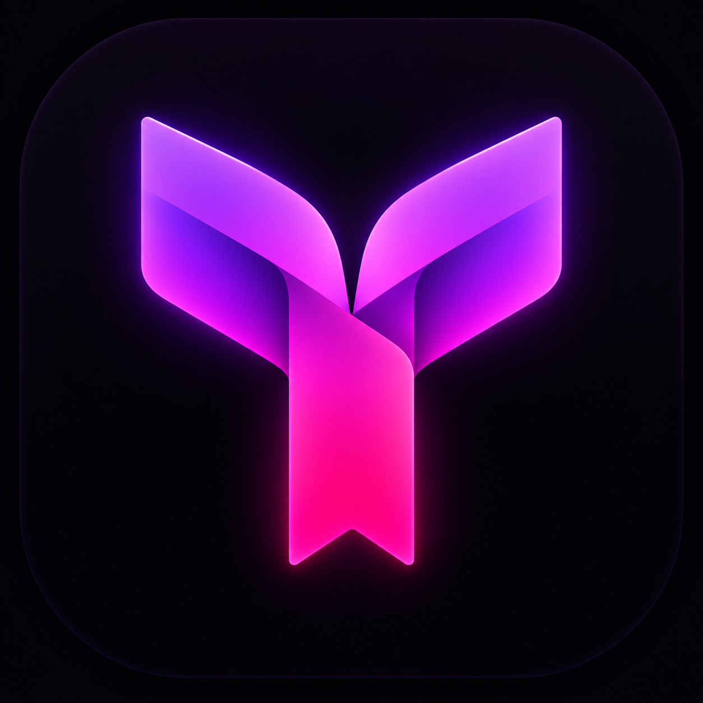
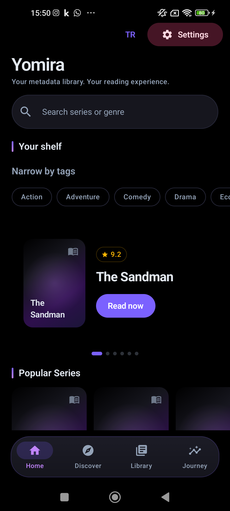
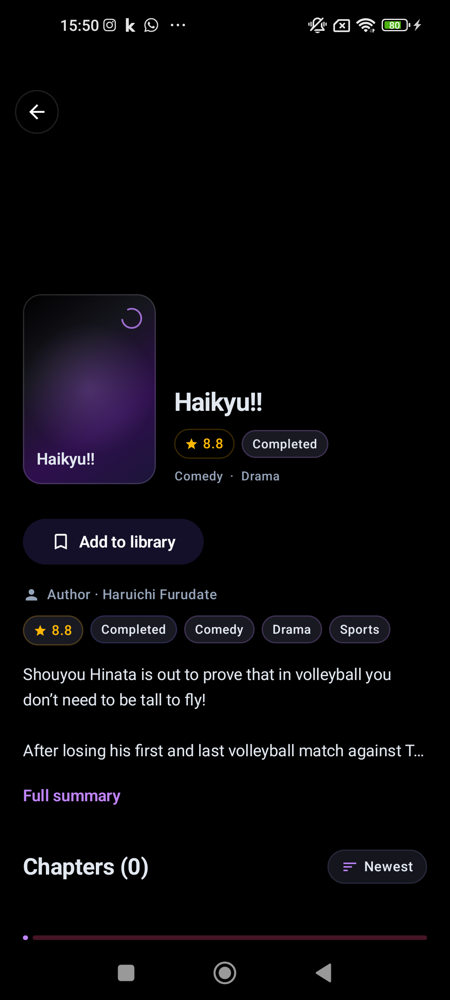
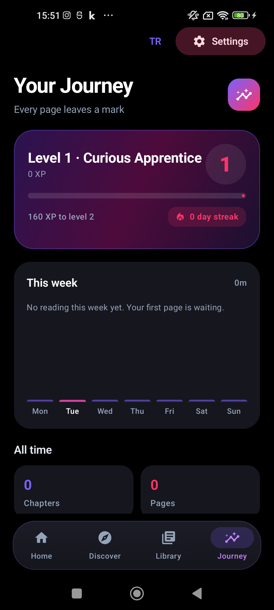

<div align="center">



# Yomira

### Senin kitaplığın. Senin kaynakların. Senin okuma ritmin.

Manga · Manhwa · Webtoon · Batı çizgi romanları<br />
**Android için özgür ve açık kaynak okuma deneyimi — OLED Plum tasarımıyla.**

[](release/RELEASE_NOTES_v8.0.4-Beta.md)
[](https://developer.android.com/about/versions/oreo)
[](LICENSE)

[İndir](#indir) · [Gerçek Cihaz Görselleri](#ekran-goruntuleri) · [Özellik Matrisi](#ozellikler) · [Derle](#derleme) · [Sürüm Notları](release/RELEASE_NOTES_v8.0.4-Beta.md)

</div>

---

**v8 ailesi, tek bakışta:** bağımsız eklentiler, çoklu kaynak yedeği, Stealth Shield,
kişiselleşen keşif, yeni bölüm takibi ve bulut yedekleri.
**v8.0.4-Beta'nın odağı:** Google hesabıyla Drive bağlantısı, hesap durumunu görme ve güvenli hesap ayırma.

<a id="indir"></a>
## 📥 İndir ve okumaya başla

| Platform | Doğrudan APK | Paket | Boyut |
| :--- | :--- | :--- | ---: |
| **Android 8.0+ · API 26+** | [`yomira-v8.0.4-beta.apk`](https://github.com/PaelenRune/Yomira/releases/download/v8.0.4-Beta/yomira-v8.0.4-Beta.apk) | İmzalı, R8 ile küçültülmüş release | ~18,6 MiB |

> **Yayın durumu:** v8.0.4-Beta APK'sı yerel olarak derlenip doğrulandı; GitHub sürüm
> varlığı henüz yayımlanmadı. Yukarıdaki bağlantı yayın tamamlanınca kullanılabilir.
> Dosya adı yayın iş akışında `yomira-v8.0.4-Beta.apk` olarak üretilir.
> Şu an indirilebilir sürüm için [en son yayımlanan sürüme](https://github.com/PaelenRune/Yomira/releases/latest) bak.

- **Bütün sürüm varlıkları:** [GitHub Releases](https://github.com/PaelenRune/Yomira/releases) — APK, sürüm notları ve SHA-256 sağlama toplamları.
- **Doğrulanmış boyut:** 19.481.781 bayt (~19,5 MB / 18,6 MiB). [Derleme, test ve imza raporu](release/VALIDATION_v8.0.4-Beta.md).
- **Güncelleme:** Aynı imzalı sürümü mevcut kurulumun üzerine yükleyerek kitaplığını ve ilerlemeni koru. Önce yedek almak her zaman iyi fikirdir.
- **Kurulum:** Android isterse APK'yı açtığın tarayıcı veya dosya yöneticisine “Bilinmeyen uygulamaları yükle” izni ver.

<a id="ekran-goruntuleri"></a>
## 📸 Gerçek cihaz, gerçek arayüz

**Xiaomi Mi 10T** üzerinde alınmış ekran görüntüleri; cihaz maketi değildir.
Görseller önceki cihaz testlerinden arşivdir, v8.0.4-Beta'nın tüm ekranlarını veya özelliklerini doğrulamaz.

<div align="center">





<sub><b>Keşfet</b> → <b>Kitaplığına ekle</b> → <b>Yolculuğunu takip et</b></sub>

</div>

<details>
<summary>Cihaz testi ve görsel kaynağı</summary>

Bu görseller v6.0.0-Beta cihaz testinden gelir. Kaynak eşleştirme, kapak yükleme ve
okuyucu doğrulamasının sınırları dahil ayrıntılar:
[Xiaomi Mi 10T cihaz test raporu](art/TASK_009_live_device_test.md).

</details>

<a id="ozellikler"></a>
## ✨ v8 özellik matrisi

### 🧭 Kaynak özgürlüğü ve keşif

| Özellik | Sana ne kazandırır? |
| :--- | :--- |
| 🏛️ **Mihon & Nuvio felsefesi** | Açık kaynak metadata tarayıcısı ve okuyucu yaklaşımı: Yomira bölüm barındırmaz veya dağıtmaz; bağımsız eklentiler ve depo seçimi kullanıcı kontrolündedir. İçerik erişimi, seçtiğin kaynağın koşullarına ve kullanım hakkına bağlıdır. |
| 🧩 **Mihon-style eklenti mağazası** | Ana ekran üst çubuğu veya **Ayarlar → Eklentiler** üzerinden depo ekle; eklenti/kaynak ara, TR/EN ve kurulum filtrelerini kullan, yükle (Install), güncelle veya kaldır. |
| 👑 **MangaUpdates · AniList · Kitsu omurgası** | MangaUpdates (Baka-Updates), AniList ve Kitsu metadata entegrasyonlarıyla geniş seri keşfi, alternatif adlar ve zengin seri bilgileri. Katalog kapsamı ve erişilebilirlik sağlayıcılara bağlıdır; sabit bir yerel 200.000+ seri arşivi değildir. |
| 🧬 **Zamanla evrilen akıllı ana sayfa** | Okuma alışkanlıklarınla öncelik kazanan tür vitrinleri ve sağlayıcıların global okuyucu/popülerlik verileriyle keşif. Solo Leveling ve One Piece gibi serilerin sırası güncel verilere göre değişir. |
| 📺 **İzlenebilir içerik rozetleri** | Uygun metadata bulunan poster ve detaylarda **Anime, Hentai OVA, K-Drama ve Donghua** uyarlama rozetleri. Rozetler video yayını veya izleme bağlantısı taahhüdü değildir. |

### 📖 Kesintisiz okuma ve yaşayan kitaplık

| Özellik | Sana ne kazandırır? |
| :--- | :--- |
| 🔄 **Akıllı çoklu kaynak yedeği — Multi-Source Fallback** | Birincil kaynakta 404 veya yükleme hatası olduğunda eşleşen alternatif kaynaktan devam etmeyi dener. Kesintisiz geçiş, aynı bölümün erişilebilir başka bir kaynakta bulunmasına bağlıdır. |
| 🌐 **Dile duyarlı kaynak eşleştirme** | Başlangıçta veya ayarlarda seçtiğin **TR/EN** diline göre kaynakları önceliklendirir; uyumsuz tek dilli kaynakları filtreler. |
| 🔔 **Updates Hub — yeni bölüm takip alanı** | Kitaplığındaki serilere gelen yeni bölümleri kronolojik akışta gör; **+X Bölüm** rozetiyle yenilikleri ayırt et ve tek dokunuşla okumaya geç. |
| 👁️ **Okunan bölüm kontrastı** | Okunmuş bölümler **%38 opaklıkla** geri planda kalır; okunmamış bölümler tam belirginliğini korur. Bölüm seçimi sade ve hızlıdır. |
| 🎮 **Steam-style başarım bildirimi ve ses** | Üstten kayan animasyonlu başarım banner'ı, sesli başarı tınısı (audio chime), seviye ve okuma yolculuğuyla ilerlemeni kutla. |
| 📖 **Akıcı okuyucu · OLED Plum** | Dikişsiz webtoon akışı, sağdan sola manga okuma, otomatik okuma geçmişi ve kaldığın yerden devam; koyu siyah zemin ve mor aksanlarla tek tasarım dili. |

### 🛡️ Gizlilik, kontrol ve yedekleme

| Özellik | Sana ne kazandırır? |
| :--- | :--- |
| 🛡️ **Dahili Stealth Shield** | **Cloudflare 1.1.1.1 / Quad9** ve yedek şifreli çözümleyiciyle DNS-over-HTTPS; Anti-DPI için TLS ClientHello/SNI parçalama denemesi. Ayrı VPN uygulaması kurmadan uygulama içi ağ koruması sunar; VPN veya anonimlik garantisi değildir. |
| 📋 **4 adımlı başlangıç anketi ve kara liste** | Dil, **18+ / 18 yaş altı güvenli mod**, içerik tercihleri ve tür seçimleriyle kişisel başlangıç. **Futanari, Yaoi, Yuri ve NTR** gibi etiketleri gizle; filtreleme mevcut metadata doğruluğuna bağlıdır. |
| 🔒 **Gizli Kasa — Vault** | Biyometrik veya cihaz kimlik doğrulamasıyla korunan özel arşiv; kapalıyken görünmeyen kasa yaklaşımı. |
| ☁️ **Google Drive & WebDAV bulut senkronizasyonu** | Google hesabıyla giriş yap, bağlı hesabı gör, manuel/otomatik eşitlemeyi yönet veya hesabı ayır. Drive yedekleri uygulamaya özel **`appDataFolder`** alanında tutulur; WebDAV ve Mihon/Tachiyomi **`.tachibk`** yedek uyumluluğu da desteklenir. |
| 🔴 **Fabrika ayarlarına dönüş — tam sıfırlama** | **Ayarlar → Depolama → Tüm Verileri Sıfırla**: onaydan sonra yerel uygulama verileri silinir, uygulama kapanır ve sonraki açılışta ilk kurulum başlar. Drive yedekleri ve dışa aktarılan dosyalar korunur. |

> **Güvenlik sınırı:** Stealth Shield IP adresini gizlemez; trafiği yeniden birleştirebilen
> gözlemciler SNI bilgisini görebilir. Her ağda sansür aşma veya “tam takip edilemezlik” vaat edilmez.
> Bağımsız eklentileri yalnızca güvendiğin depolardan yükle.

> **Drive kurulum notu:** Google Drive bağlantısı için Drive API, OAuth onay ekranı ve
> paket/imza kaydı yapılandırılmalıdır. Gerçek Google hesabıyla uçtan uca bağlantı henüz
> doğrulanmamıştır. [Kurulum ve cihaz kontrol listesi](docs/GOOGLE_DRIVE_AUTH.md).

<a id="derleme"></a>
## 🔨 Kaynaktan derle

**Gereksinimler:** JDK 17 · Android SDK 35 · Android SDK yolu yapılandırması (`local.properties` veya `ANDROID_HOME`).
Depodaki Gradle wrapper'ı kullan; ayrıca Gradle kurman gerekmez.

```bash
./gradlew assembleRelease
```

Windows / PowerShell:

```powershell
.\gradlew.bat assembleRelease
```

**Çıktı:** `app/build/outputs/apk/release/app-release.apk`<br />
Release yapılandırması APK'yı imzalar; R8 kod küçültme ve kaynak küçültme etkindir.

<details>
<summary>Testler ve sürüm belgeleri</summary>

```bash
./gradlew :feature:settings:testDebugUnitTest :app:testDebugUnitTest
```

- [v8.0.4-Beta sürüm notları](release/RELEASE_NOTES_v8.0.4-Beta.md)
- [v8.0.4-Beta test, derleme ve imza doğrulaması](release/VALIDATION_v8.0.4-Beta.md)
- [v8.0.3-Beta — İngilizce kapak önceliği](release/RELEASE_NOTES_v8.0.3-Beta.md)
- [v8.0.2-Beta — Eklenti yönetimi](release/RELEASE_NOTES_v8.0.2-Beta.md)
- [v8.0.1-Beta — Tam sıfırlama](release/RELEASE_NOTES_v8.0.1-Beta.md)

</details>

## 📄 Lisans ve içerik sorumluluğu

**[Apache License 2.0](LICENSE)** · © 2026 PaelenRune

Yomira bölüm barındırmaz veya dağıtmaz. Metadata sağlayıcıları ve bağımsız kaynaklar
kendi koşullarına tabidir; yalnızca erişim hakkın bulunan içerikleri kullan.
Açık kaynak lisansı, üçüncü taraf içeriklerin kullanım hakkını veya her ülkede hukuki uygunluğu garanti etmez.

<div align="center">

<sub><b>Yomira</b> · Keşfet. Oku. Kendi ritmini bul.</sub>

</div>
