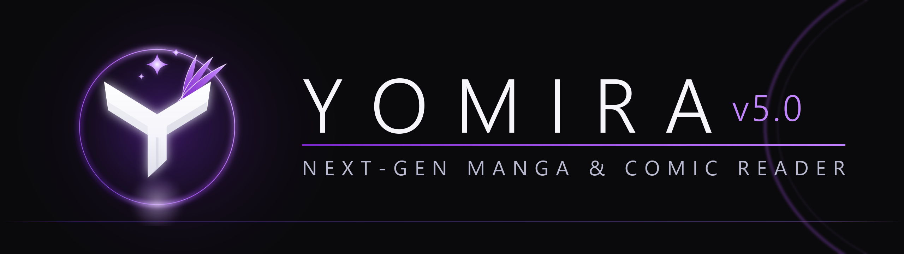
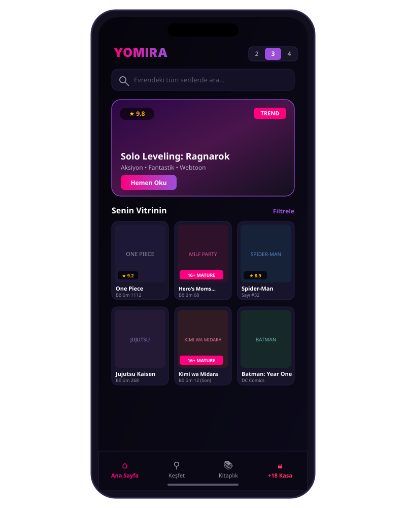
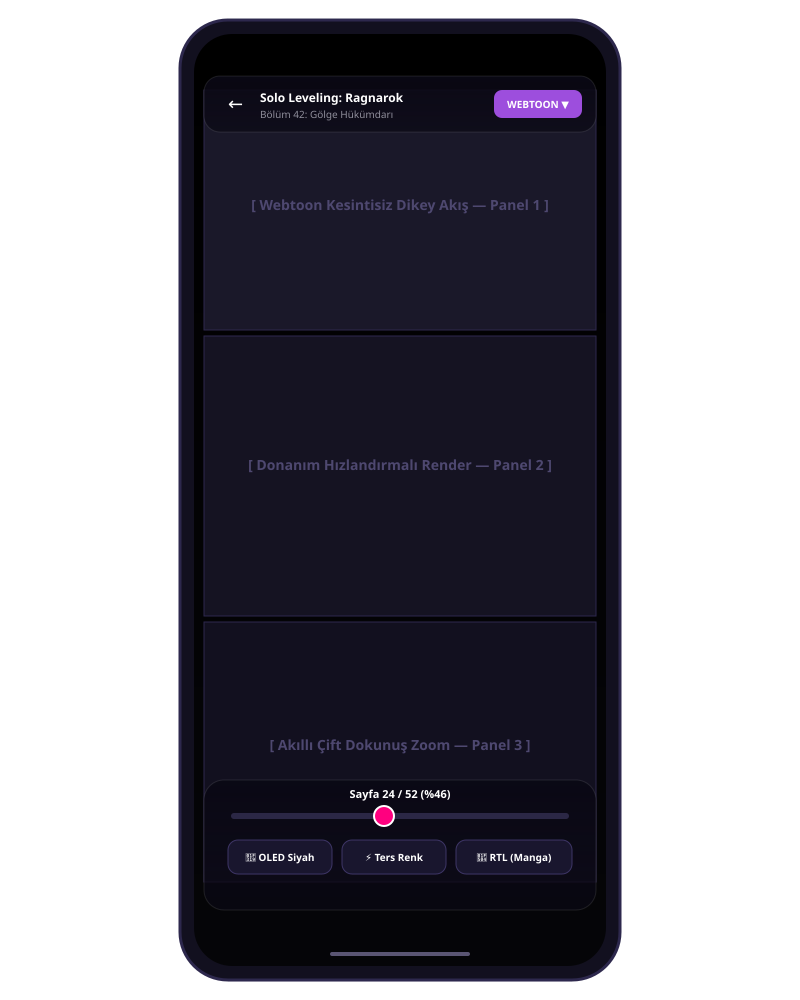

<div align="center">



# YOMIRA
### Hikâyenin ritmini yakala.

[](https://github.com/PaelenRune/Yomira/releases)
[](https://github.com/PaelenRune/Yomira/releases)
[](https://developer.android.com/jetpack/compose)
[](LICENSE)

**Manga, webtoon, manhwa, manhua ve Batı çizgi romanları için açık kaynak çok platformlu okuma deneyimi. Android ve bağımsız Windows masaüstü, Dribbble ilhamlı OLED tasarım, Türkçe / English arayüz ve sana ait bir okuma yolculuğu.**

[**Android için indir**](https://github.com/PaelenRune/Yomira/releases/latest) · [**Windows için indir (.EXE / .MSI)**](https://github.com/PaelenRune/Yomira/releases/latest) · [**Ürün vitrini**](https://paelenrune.github.io/Yomira/) · [**English overview**](#english)

</div>

## Okumaya odaklan

- **120 Hz akıcı okuyucu:** Uyumlu ekranlarda akıcı geçişler; manga için sağdan sola, Batı çizgi romanları için soldan sağa, webtoon için kesintisiz dikey akış. 120 Hz uyumlu seam sökücü ve donanım bitmap geri dönüşüm havuzu ile hafızada hafif, ekranda pürüzsüz. Gerçek yenileme hızı cihaz ve sistem ayarlarına bağlıdır.
- **Guided View (Akıllı Panel):** Cihaz üzerinde, internet gerektirmeden çalışan panel dedektörü ile panelden panele sinematik akış ve konuşma balonlarına net odaklanma. **Çift Sayfa Birleştirici** iki sayfaya bölünmüş geniş sahneleri sıfır dikişle yan yana getirir.
- **Yomira Reading Journey & Wrapped:** Cihazda kalan yerel okuma takip motoru; 4 kategori ve 4 kademeli rozetler, seviye & XP ilerlemesi. Aylık ve yıllık okuma alışkanlıklarını sinematik **Yomira Wrapped** slaytları ve paylaşılabilir kartlarla keşfet.
- **Spoiler-Free Bölüm Hatırlatıcı:** Uzun ara verdiğin seriye dönerken yalnızca *okuduğun* bölümlere kadarki olayları ve karakterleri özetler; gelecekten asla spoiler vermez.
- **Windows Masaüstü & Tablet 2-Pane:** Compose Multiplatform ile yazılmış bağımsız Windows uygulaması — 2K/4K monitörlerde 6-8 sütunlu poster ızgarası, F11 tam ekran, yön tuşları ve fare tekerleğiyle webtoon kaydırma. Tablet ve katlanabilirlerde dinamik 2-Pane düzen ve Yan Gezinme Rayı.
- **JSON-first eklenti ekosistemi:** Eklentiler sistem yükleyicisi gerektirmeden Yomira sandbox'ında çalışır; Keiyoushi ve topluluk depolarını kendin bağla. **Mihon / Tachiyomi yedeklerini** (`.tachibk` veya JSON) tek dokunuşla içe aktar — kütüphane, kategoriler ve ilerlemeler seninle gelir.
- **Batı çizgi romanları:** Marvel, DC ve Image gibi yayınevlerinin eserlerini metadata kataloğunda keşfet; erişim hakkın bulunan kaynaklarla oku.
- **Dribbble OLED teması & çift dilli deneyim:** Derin siyah zemin, mor / fuşya vurgular, poster odaklı raflar; Türkçe [TR] ve English [EN] arayüz.

## Arayüzden bir bakış

| Ana sayfa | Evrensel okuyucu |
| :---: | :---: |
|  |  |

*Görseller tasarım önizlemeleridir; cihaz ve sürüme göre görünüm değişebilir.*

## Üç platform, tek ritim

1. **Android:** [En güncel APK'yı](https://github.com/PaelenRune/Yomira/releases/latest) kur — telefon, tablet ve katlanabilirlerde uyarlanabilir düzen.
2. **Windows:** [Masaüstü sürümü](https://github.com/PaelenRune/Yomira/releases/latest) (.EXE / .MSI) ile büyük ekranda 6-8 sütunlu vitrin.
3. **Başla:** Okuma dilini seç (**Türkçe [TR] / English [EN]**), istersen Keiyoushi ve topluluk depolarını bağla ya da Mihon/Tachiyomi yedeğini içe aktar; hepsi daha sonra Ayarlar'dan da yönetilebilir.

## İçerik değil, okuma aracı

Yomira bölüm barındırmaz, dağıtmaz veya erişim hakkı sağlamaz. Katalog bilgileri ile okunabilir içerik birbirinden ayrıdır; eklentiler ve harici hizmetler kendi koşullarına tabidir. Yalnızca erişim hakkınız bulunan içerikleri kullanın ve eser sahiplerinin haklarına saygı gösterin. Yayıncı adları tanımlama amacıyla kullanılır; herhangi bir resmî ortaklık veya onay ima edilmez.

## Geliştiriciler için

Kotlin, Jetpack Compose, Compose Multiplatform, Hilt, Room ve modüler mimari üzerine kuruludur.

| Dizin | Sorumluluk |
| --- | --- |
| `app/` | Android uygulama başlangıcı, gezinme ve bağımlılık yönetimi |
| `desktop/` | Bağımsız Windows masaüstü uygulaması (Compose Multiplatform, EXE/MSI) |
| `core/` | Paylaşılan modeller, veri tabanı, ağ ve tasarım sistemi |
| `data/` | Metadata, eklenti ve senkronizasyon uygulamaları |
| `domain/` | İş kuralları, okuma yolculuğu motoru ve kaynak eşleştirme |
| `feature/` | Katalog, okuyucu, yolculuk, detay ve ayarlar deneyimleri |

```powershell
.\gradlew.bat assembleDebug
.\gradlew.bat testDebugUnitTest
.\gradlew.bat :desktop:packageDistributionForCurrentOS
```

Sorun bildirimlerinde platformu, işletim sistemi sürümünü ve yeniden üretme adımlarını paylaşın. Katkılar ve erişilebilirlik iyileştirmeleri memnuniyetle karşılanır.

## English

**Yomira is an open-source reader for manga, webtoons and Western comics — on Android and on a standalone Windows desktop app.** Enjoy an OLED-first interface inspired by Dribbble, Turkish / English navigation, a reader targeting smooth 120 Hz interaction, on-device Guided View panel navigation with spread stitching, Yomira Reading Journey achievements with shareable monthly Wrapped summaries, spoiler-free chapter recaps, and a sandboxed JSON-first extension engine that imports your Mihon / Tachiyomi backup in one tap.

Choose your reading language, then connect Keiyoushi and community repositories—or restore a backup; everything stays manageable in Settings. Yomira does not host chapters or grant access to copyrighted works. Use only content you are entitled to access; publisher names do not imply endorsement.

[Download for Android](https://github.com/PaelenRune/Yomira/releases/latest) · [Download for Windows](https://github.com/PaelenRune/Yomira/releases/latest) · [Explore the product](https://paelenrune.github.io/Yomira/)

## Lisans / License

[Apache License 2.0](LICENSE) · © 2026 PaelenRune
