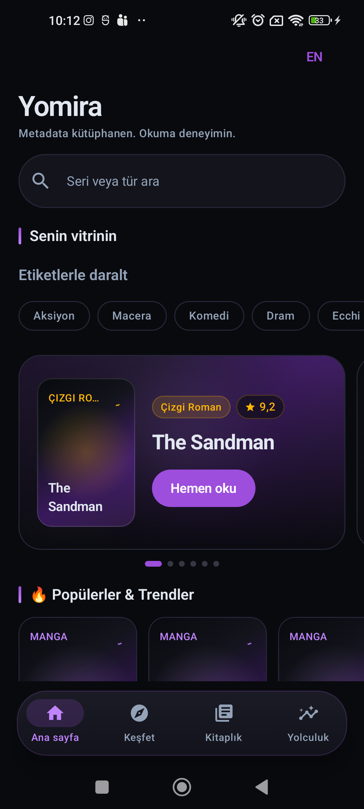
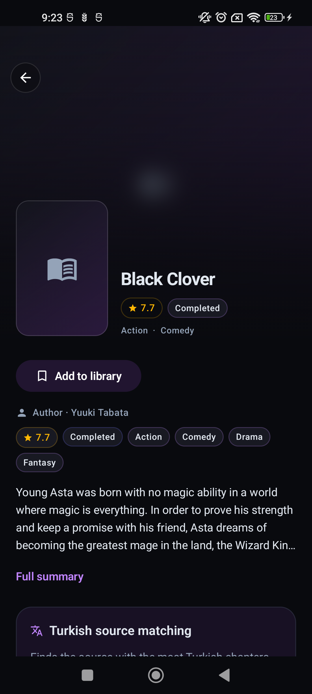
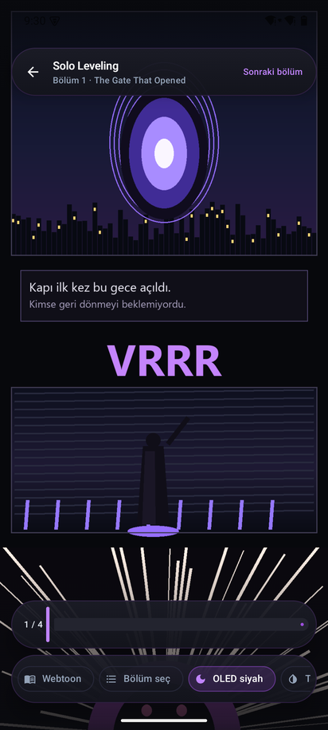

<div align="center">


# Yomira

*Free and open source manga and comic reader for Android.*

Manga, manhwa, webtoon ve Batı çizgi romanları için tek kütüphane, tek OLED Plum tasarım dili —
Android'de.

[](https://github.com/PaelenRune/Yomira/releases/latest)
[](https://github.com/PaelenRune/Yomira/releases/latest)
[](https://developer.android.com/jetpack/compose)
[](LICENSE)

[Hızlı İndirme](#-hızlı-indirme-download) · [Ekran Görüntüleri](#-ekran-görüntüleri) · [Özellikler](#-özellikler) · [Derleme](#-derleme) · [Sürüm Notları](release/RELEASE_NOTES.md)

</div>

## 📥 Hızlı İndirme (Download)

| Platform | İndirme | Boyut |
| :--- | :--- | ---: |
| 🤖 **Android · Universal** | [`yomira-v5.1.0.apk`](https://github.com/PaelenRune/Yomira/releases/latest/download/yomira-v5.1.0.apk) | ~24.8 MB |
| 🤖 **Android · arm64-v8a** | [`yomira-arm64-v8a-v5.1.0.apk`](https://github.com/PaelenRune/Yomira/releases/latest/download/yomira-arm64-v8a-v5.1.0.apk) | ~24.5 MB |

> **Gereksinimler:** Android 8.0+ (API 26).
> Diğer ABI paketleri (`armeabi-v7a`, `x86_64`) ve [`SHA256SUMS.txt`](https://github.com/PaelenRune/Yomira/releases/latest/download/SHA256SUMS.txt)
> için [tüm asset'lere](https://github.com/PaelenRune/Yomira/releases/latest) bak. Aynı imza
> anahtarı sayesinde yeni sürüm eski kurulumun **üzerine** kurulur; kütüphane ve ilerleme korunur.

## 📸 Ekran Görüntüleri

Android görselleri **Xiaomi Mi 10T** gerçek cihazından alınmıştır — mockup değildir.

<div align="center">

 &nbsp;
 &nbsp;


<sub><b>Android</b> · Xiaomi Mi 10T — ana raf, dile duyarlı kaynak eşleştirmeli seri detayı ve okuyucu</sub>

</div>

## ✨ Özellikler

- 🗑️ **Fabrika Ayarlarına Dön (v8.0.1-Beta)** — Ayarlar → Depolama bölümündeki
  “Tüm Verileri Sıfırla” onayından sonra tüm yerel uygulama verileri silinir ve uygulama kapanır.
  Yeniden açıldığında ilk kurulum başlar. Drive yedekleri ve dışa aktarılan dosyalar korunur.
  Ayrıntılar: [v8.0.1-Beta sürüm notları](release/RELEASE_NOTES_v8.0.1-Beta.md).
- 🌐 **Dile duyarlı akıllı kaynak eşleştirme (Smart Matching)** — Onboarding sihirbazında veya
  ayarlarda seçilen aktif dil (TR/EN) birincil sıralama anahtarı olarak kullanılır. Doğru dildeki
  kaynaklar en başa yerleşir, uyumsuz tek dilli kaynaklar filtrelenir.
- 📖 **Gelişmiş Okuma Deneyimi** — Dikişsiz webtoon akışı, manga sağdan sola modu ve 120 Hz
  yenileme hızında akıcı kaydırma.
- 🎨 **Saf OLED Plum Teması** — Pil tasarruflu koyu siyah arka plan ve mor aksanlar; tüm
  platformlarda tek palet.
- 🔒 **Gizli Kasa (Vault)** — Biyometrik veya PIN ile kilitlenebilen özel arşiv; kapalıyken
  arayüzde iz bırakmaz.
- 🔄 **Yedekleme & İlerleme** — Otomatik okuma geçmişi, kaldığın yerden devam ve yerel
  yedekleme (Mihon / Tachiyomi `.tachibk` uyumlu).

## 🔨 Derleme

**Gereksinimler:** JDK 17 · Android SDK 35 · Gradle wrapper.

```bash
# Android — universal + ABI bazlı imzalı APK'lar
./gradlew assembleRelease
```

Çıktılar: `app/build/outputs/apk/release/`.
Release derlemeleri R8 tam modda çalışır; Room, Hilt, kotlinx.serialization ve WorkManager
sınıfları `app/proguard-rules.pro` içinde korunur.

## 📄 Lisans

[Apache License 2.0](LICENSE) · © 2026 PaelenRune

<sub>Yomira bölüm barındırmaz veya dağıtmaz; yalnızca erişim hakkın bulunan içerikleri kullan.</sub>
